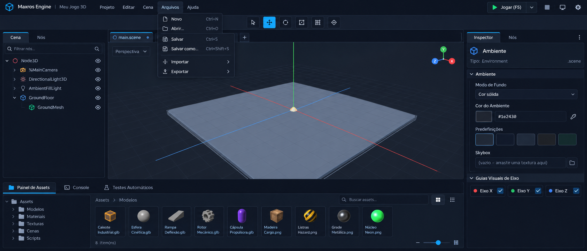

# Maxros Engine — Unificação da Física ao Ciclo de Vida das Classes JavaScript (`update(delta)`), Cenas Instanciadas, Editor de Scripts e Nova Interface Visual

Este plano incorpora a **Revisão Arquitetural de Unificação da Física**, eliminando o `PhysicsScript` como componente separado e integrando **todas as suas funcionalidades físicas e a simulação `cannon-es`** diretamente aos Nodes 3D (`Node3D`, `Mesh3D`, `RigidBody3DNode`) e ao ciclo de vida **`update(delta)`** das classes JavaScript estendidas (`export default class extends ...`).

---

## 1. Diagnóstico do `PhysicsScript` Atual e Mapeamento de Funcionalidades Preservadas

Após examinar integralmente `src/engine/nodes/EngineNode.js`, `src/engine/nodes/RigidBody3DNode.js`, `src/engine/nodes/CollisionShape3DNode.js`, `src/engine/physics/PhysicsServer.js` e `src/App.tsx`, identificamos todas as funcionalidades físicas existentes que serão **100% preservadas e unificadas diretamente nos Nodes 3D**:

| Funcionalidade Existente | Onde estava no `PhysicsScript` / `RigidBody3DNode` | Como passa a funcionar na Arquitetura Unificada (Direto no Node + `update(delta)`) |
| :--- | :--- | :--- |
| **Ativação e Modo Físico (`bodyType`)** | `comp.params.bodyType` (`'dynamic' \| 'static' \| 'kinematic'`) e `RigidBody3DNode.bodyType` | Propriedade nativa direta do Node 3D: `this.physicsMode = 'none' \| 'dynamic' \| 'static' \| 'kinematic'` (ou `this.bodyType` em `RigidBody3DNode` / `Mesh3D` / `Node3D`). Não requer componente externo. |
| **Gravidade (`gravityY` / `gravityScale` / `useGravity`)** | `comp.params.gravityY ?? -9.82` e `PhysicsServer.world.gravity` | Propriedades diretas `this.gravityY` (`-9.82`), `this.gravityScale` (`1.0`) e `this.useGravity` (`true`), integradas ao passo físico do Node. |
| **Velocidade e Aceleração (`velocity`, `angularVelocity`, `acceleration`)** | `this._physicsState.vx/vy/vz` e `this.body.velocity` / `angularVelocity` | Propriedades vetoriais diretas no Node (`this.velocity`, `this.angularVelocity`, `this.acceleration`) acessíveis e manipuláveis diretamente dentro de `update(delta)` (ex.: `this.velocity.x = 5`, `this.velocity.y = 8`). |
| **Massa (`mass`)** | `comp.params.mass ?? 1.0` e `RigidBody3DNode.mass` | Propriedade nativa `this.mass` (em kg, padrão `1.0` para corpos dinâmicos, `0` para estáticos/cinemáticos), sincronizada automaticamente com `CANNON.Body`. |
| **Quique / Elasticidade (`restitution`)** | `comp.params.restitution ?? 0.35` (inversão de velocidade no impacto) | Propriedade nativa `this.restitution` (`0.0` a `1.0`, padrão `0.35`), aplicada tanto no `CANNON.Material` do corpo físico quanto na resolução de impacto com superfícies e piso (`floorY`). |
| **Atrito e Resistência (`friction`, `linearDamping`, `angularDamping`)** | `comp.params.linearDamping ?? 0.02` e `body.linearDamping` / `angularDamping` | Propriedades nativas `this.friction` (`0.3`), `this.linearDamping` (`0.02`) e `this.angularDamping` (`0.01`), controlando desaceleração contínua e atrito de superfície. |
| **Aplicação de Forças e Impulsos** | `body.wakeUp()`, `body.velocity`, `body.force`, `body.torque` | Métodos nativos no próprio Node: `this.applyForce(forceVec, worldPoint)`, `this.applyImpulse(impulseVec, worldPoint)`, `this.applyTorque(torqueVec)` e `this.addVelocity(vec)`. |
| **Colisões Geométricas e por Modelo 3D (`CollisionShape3DNode`)** | Filhos `CollisionShape3DNode` (`Box`, `Sphere`, `Cylinder`, `Trimesh / Malha 3D`) | Qualquer `Node3D` / `Mesh3D` / `RigidBody3DNode` com física ativa reconstrói automaticamente suas formas `CANNON.Shape` a partir de seus filhos `CollisionShape3DNode` (ou gera um colisor automático a partir da própria geometria se não houver filho explícito). |
| **Detecção de Contato e Resolução de Colisões** | Solver `cannon-es` + contato de piso (`floorY`) | Estado de contato consultável diretamente em `update(delta)` via `this.isOnFloor()`, `this.isColliding()`, `this.getContacts()` e `this.getCollidingNodes()`, além de callbacks opcionais na classe JS (`onCollisionEnter(other, contact)`, `onCollisionStay`, `onCollisionExit`). |
| **Sincronização Corpo Físico ↔ Transformação Visual** | `syncTransformToBody()` e `syncBodyToTransform()` | Sincronização bidirecional unificada dentro do pipeline do `update(delta)` sem execução duplicada e respeitando hierarquias pai/filho (`matrixWorld`). |

---

## 2. Unificação da Física com `update(delta)` e Regras de Integração com o Motor Físico

### 2.1. Eliminação da Duplicidade (`PhysicsScript` Removido como Sistema Independente)
- **Sem segunda atualização**: O bloco legado `if (comp.type === 'Physics')` dentro de `_executeBehaviorComponents(delta)` será **removido**. Não haverá nenhuma atualização paralela de `PhysicsScript` antes ou depois do `update(delta)`.
- **Migração Transparente de Cenas Existentes**: Ao desserializar qualquer `.scene.json` antigo que contenha um item `{ type: 'Physics', params: { ... } }` em `node.components`, o `EngineNode.deserialize()` converterá automaticamente esses parâmetros (`bodyType`, `mass`, `gravityY`, `restitution`, `linearDamping`, `floorY`, `velocityX/Y/Z`) para as propriedades físicas nativas do próprio Node e removerá a entrada `'Physics'` de `components`.
- **Inspector Limpo**: O Inspector não exibirá mais o botão `+ Physics (Script Física)` na seção de componentes. As propriedades físicas farão parte direta das propriedades nativas do Node no Inspector (`Física do Node`), enquanto `Rotator`, `Oscillator` e `Thruster` permanecem compatíveis e operando normalmente integrados ao estado físico unificado do Node.

### 2.2. Como o `update(delta)` Centraliza o Comportamento e Protege a Simulação Física

O desenvolvedor escreve apenas sua classe JavaScript estendendo o Node:

```javascript
export default class Player extends Mesh3D {
  start() {
    this.physicsMode = 'dynamic';
    this.mass = 1.5;
    this.restitution = 0.35;
    this.speed = 6;
  }

  update(delta) {
    // Controle direto de velocidade horizontal pelo desenvolvedor
    if (Input.is_action_pressed('move_right')) {
      this.velocity.x = this.speed;
    } else if (Input.is_action_pressed('move_left')) {
      this.velocity.x = -this.speed;
    }

    // Pulo usando detecção de contato física nativa
    if (Input.is_action_just_pressed('jump') && this.isOnFloor()) {
      this.applyImpulse({ x: 0, y: 8.5, z: 0 });
    }
  }
}
```

### 2.3. Pipeline Interno de `update(delta)` sem Invalidação de Colisões

Para garantir que o `update(delta)` da classe JavaScript seja o ponto central de atualização **sem permitir que alterações personalizadas de posição/velocidade atravessem paredes, sobrescrevam resultados de colisões ou executem física duplicada**, a engine processa cada frame da seguinte forma coordenada:

```text
┌────────────────────────────────────────────────────────────────────────────────────────┐
│               CICLO UNIFICADO DE ATUALIZAÇÃO E FÍSICA POR FRAME (delta)                │
├────────────────────────────────────────────────────────────────────────────────────────┤
│  1. ATUALIZAÇÃO DO NODE E CLASSE JAVASCRIPT (`node.update(delta)`)                     │
│     • Para cada Node ativo (`nodeState === 'active'`), executa `this.update(delta)`.   │
│     • No `update(delta)`, o desenvolvedor lê o estado físico real do frame anterior    │
│       (`this.isOnFloor()`, `this.velocity`, `this.position`, `this.getContacts()`) e   │
│       define intenções de movimento (`this.velocity`, `this.applyForce()`,             │
│       `this.applyImpulse()`, ou deslocamento cinemático/direto).                       │
│     • Modificadores auxiliares (`Rotator`, `Oscillator`, `Thruster`) aplicam seus      │
│       impulsos/rotações diretamente nas propriedades nativas do Node (ex.: `Thruster`  │
│       usa `this.applyImpulse({ x: 0, y: impulseY, z: 0 })`).                           │
├────────────────────────────────────────────────────────────────────────────────────────┤
│  2. RECONCILIAÇÃO PRÉ-SOLVER (Intenção do Desenvolvedor → Motor Físico)                │
│     • Se o Node tem física ativa (`dynamic` ou `kinematic`):                           │
│       - Alterações em `this.velocity`, `this.angularVelocity`, forças e impulsos       │
│         acumulados em `update(delta)` são enviados ao `CANNON.Body`.                   │
│       - Se o desenvolvedor alterou `this.position` diretamente num corpo `dynamic`,    │
│         a engine converte ou sincroniza a posição antes do solver para que o           │
│         `cannon-es` valide colisões em seguida, impedindo penetração em obstáculos.    │
├────────────────────────────────────────────────────────────────────────────────────────┤
│  3. INTEGRAÇÃO FÍSICA E RESOLUÇÃO DE COLISÕES (`PhysicsServer.step(delta)`)            │
│     • Aplica gravidade (`gravityY * gravityScale`), amortecimento (`linearDamping`,    │
│       `angularDamping`), atrito (`friction`) e quique (`restitution`).                 │
│     • Resolve colisões entre todos os `CollisionShape3DNode` (`Box`, `Sphere`,         │
│       `Cylinder`, `Trimesh`) e limites de contato (`floorY`).                          │
│     • Atualiza os estados de contato (`isOnFloor`, lista de contatos ativos) e         │
│       sincroniza a transformação final validada (`syncBodyToTransform()`) de volta     │
│       para `this.position`, `this.quaternion` e `this.velocity` do Node visual.        │
└────────────────────────────────────────────────────────────────────────────────────────┘
```

**Por que essa arquitetura resolve o conflito entre script e física:**
1. **Zero Execução Duplicada**: A física roda **uma única vez por frame** integrada ao fluxo de `update(delta)`, nunca em dois loops concorrentes.
2. **Colisões Sempre Respeitadas**: Como a resolução de contatos e restrições geométricas (`cannon-es` + limites físicos) ocorre após a coleta das velocidades/forças definidas em `update(delta)` e sincroniza a posição corrigida de volta ao Node, um script que mova o objeto contra uma parede ou chão terá sua posição e velocidade devidamente corrigidas pela resolução física.
3. **Nodes sem Física Permanecem Leves**: Nodes com `physicsMode === 'none'` (padrão para luzes, câmeras, UI, grupos vazios ou malhas puramente decorativas) executam `update(delta)` diretamente sem criar `CANNON.Body` e sem custo no `PhysicsServer`, mas ativam o corpo físico automaticamente assim que `physicsMode` for definido como `'dynamic'`, `'static'` ou `'kinematic'` (ou quando possuírem um `CollisionShape3DNode` filho).

---

## 3. Fluxo Bidirecional de Cenas Instanciadas (`Origem ↔ Instâncias`)

```text
   [ Aba: EnemyScene.scene.json ]                     [ Aba: MainScene.scene.json ]
   ┌────────────────────────────┐                     ┌────────────────────────────────────────┐
   │ EnemyRoot (Mesh3D)         │                     │ MainRoot (Node3D)                      │
   │ ├── HelmetMesh             │  1. De dentro p/    │ ├── World                              │
   │ ├── WeaponMesh (NOVO!) ────┼───► fora (Salvar    │ ├── Guard_A [🎬 EnemyScene]            │
   │ └── EnemyCollider          │     Origem propaga  │ │   (localOverrides: pos=[5,0,2])      │
   └────────────────────────────┘     estrutura)      │ └── Guard_B [🎬 EnemyScene]            │
                 ▲                                    │     (localOverrides: pos=[-4,0,3])     │
                 │                                    └───────────────────┬────────────────────┘
                 └─────── 2. De fora p/ dentro (Editar Guard_A na         │
                             MainScene salva SÓ em localOverrides,        ▼
                             NUNCA altera EnemyScene.scene.json)   [MainScene.scene.json]
```

1. **De Dentro para Fora (Da Cena Original para as Instâncias)**:
   - Clicar no ícone de **claquete (`🎬`)** ao lado de uma instância abre a cena de origem em uma **nova aba superior**.
   - Salvar a cena de origem em sua própria aba propaga automaticamente todas as alterações estruturais para todas as instâncias (`Guard_A`, `Guard_B`) inseridas em outras cenas.
2. **De Fora para Dentro (Da Cena Pai para a Instância via `localOverrides`)**:
   - Alterar posição, rotação, escala, visibilidade, parâmetros físicos ou nome da instância (`Guard_A`) na cena pai (`MainScene`) grava apenas em `localOverrides` no `.scene.json` da `MainScene`, mantendo o arquivo base da `EnemyScene` intacto e sem duplicação em disco.

---

## 4. Decomposição Completa da Interface Visual (Fiel à Imagem de Referência)



1. **Barra de Menu Superior Principal**:
   - Logo + **`Maxros Engine | Meu Jogo 3D`** + menus dropdown **`Projeto`**, **`Editar`**, **`Cena`**, **`Arquivos`** (`Novo Ctrl+N`, `Abrir... Ctrl+O`, `Salvar Ctrl+S`, `Salvar como... Ctrl+Shift+S`, `Importar >`, `Exportar >`), **`Ajuda`** + alternador **`3D` | `Scripts`** + botão verde **`▶ Jogar (F5)`** com dropdown, Parar `■`, Monitor e Configurações.
2. **Barra Secundária Centralizada de Gizmos**:
   - 6 botões quadrados (`Selecionar`, `Mover`, `Rotacionar`, `Escalar`, `Snap de Grade`, `Pivô/Foco`).
3. **Painel Esquerdo (`Cena` | `Nós`)**:
   - Busca **`🔍 Filtrar nós...`**, árvore de nós com linhas guia (`└`, `├`), ícones coloridos por tipo, ícone de **Claquete (`🎬`)** para cenas instanciadas, ícone de **Pergaminho (`📜`)** para classes JS associadas e ícone de **Olho (`👁`)**.
4. **Centro (Abas de Cenas + Viewport 3D)**:
   - Barra de abas de cenas abertas (`[ ○ main.scene ● ] [ + ]`), menu **`Perspectiva v`** no canto superior esquerdo, **Gizmo de Eixos 3D (`X`, `Y`, `Z`)** no canto superior direito e linhas de eixo globais vermelha (`X`), verde (`Y`) e azul (`Z`) cruzando a origem.
5. **Painel Direito (`Inspector` | `Nós`)**:
   - Botão de **Pergaminho (`📜`)** no topo ao selecionar um Node (criar, associar, abrir na aba `Scripts`, substituir ou remover classe JS).
   - Seção **Física Nativa do Node** (Modo Físico `Nenhum / Dynamic / Static / Kinematic`, `Massa`, `Gravidade Y`, `Quique / Restitution`, `Atrito / Friction`, `Amortecimento Linear / Angular`, `Travar Rotação`) diretamente no Node, **sem `PhysicsScript` separado**.
   - Em **`Ambiente`**: `Modo de Fundo`, `Cor do Ambiente` com conta-gotas, `Predefinições`, `Skybox` e **`Guias Visuais de Eixo`** (`🔴 Eixo X [✓]`, `🟢 Eixo Y [✓]`, `🔵 Eixo Z [✓]`).
6. **Gaveta Inferior (`Painel de Assets` | `Console` | `Testes Automáticos`)**:
   - Navegador de Assets em 2 colunas: árvore de pastas à esquerda (`Assets > Modelos, Materiais, Texturas, Cenas, Scripts`) e grade/lista à direita com breadcrumb, busca, contador de itens (`8 item(ns)`) e slider de zoom dos ícones.

---

## 5. Baterias de Testes Automatizados Atualizadas (`npm test` / `src/engine/validate.js`)

Todas as baterias existentes serão preservadas (com a Bateria 27 atualizada para validar a migração automática de cenas legadas para o sistema físico unificado) e adicionaremos as novas baterias completas:

- **Bateria 27 (Atualizada) — `CollisionShape3D` (`Box`, `Sphere`, `Cylinder`, `Trimesh / MeshCollider`) & Física Nativa Unificada**: valida os 4 tipos de colisor e a migração automática de dados legados `PhysicsScript` para as propriedades físicas nativas do Node.
- **Bateria 28 — Herança Direta por Classes JavaScript (`export default class extends Node3D / Mesh3D`) & Compatibilidade**: valida instanciação direta da classe estendida, uso de `super`, rejeição de classe incompatível e isolamento entre múltiplas instâncias.
- **Bateria 29 — Física Unificada ao `update(delta)` (Gravidade, Velocidade, Forças, Quique, Atrito, Colisões `cannon-es` e Ausência de Execução Duplicada)**:
  - Verifica movimento, gravidade, massa, quique (`restitution`), atrito (`friction` / `linearDamping`) e aplicação de forças/impulsos (`applyForce`, `applyImpulse`) controlados diretamente dentro de `update(delta)`.
  - Verifica que o código personalizado em `update(delta)` interage com a simulação física sem invalidar a resolução de colisões e sem execução duplicada.
  - Verifica independência física entre múltiplas instâncias e custo zero em Nodes sem comportamento físico (`physicsMode: 'none'`).
- **Bateria 30 — Ciclo de Vida Completo (`start`, `input`, `update`, `onDestroy`), Estados (`Ativo`, `Inativo`, `Pausado`, `Destruído`) & Sistema `Input`**:
  - Verifica execução única de `start()` e `onDestroy()`, preservação em pausa/desativação, Nodes criados dinamicamente em runtime, `Input.is_action_pressed` / `just_pressed` / `just_released`, consumo de evento (`event.consume()`) e bloqueio por foco do editor.
- **Bateria 31 — Cenas Instanciadas (`Origem → Instâncias` e `Cena Pai → localOverrides`) & Busca Recursiva de Câmeras**:
  - Verifica propagação de dentro para fora ao salvar a cena de origem, encapsulamento de fora para dentro via `localOverrides`, independência de instâncias em runtime e busca recursiva de `Camera3D`.
